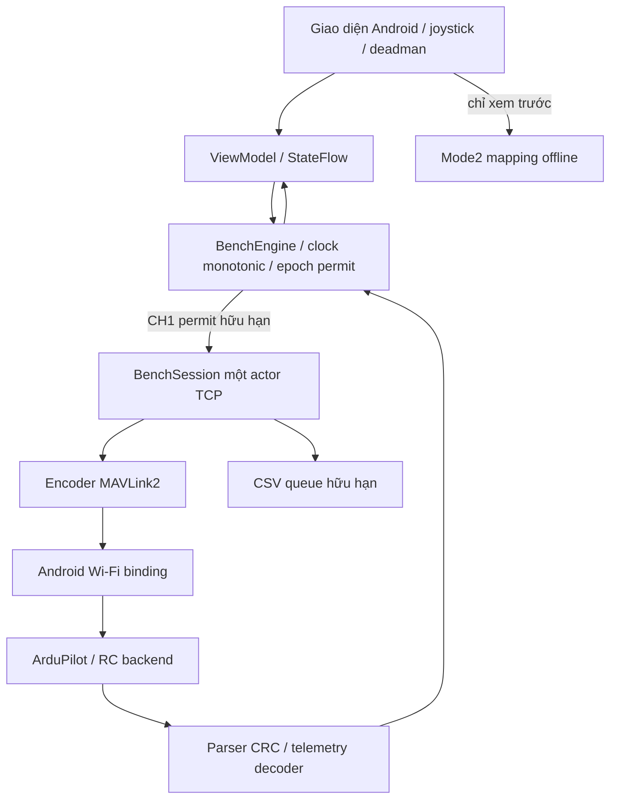

# Kiến trúc, quyền phát và mapping RC

Socket RX/TX và scheduler độc lập render. UI nhận snapshot khoảng 10 Hz; RC tối đa 20 Hz, HEARTBEAT GCS 1 Hz. Không catch up tick cũ. Chỉ một frame pending; nếu quyền RC bị thu hồi khi frame đã ghi một phần thì đóng socket thay vì hoàn tất gói cũ. Đồng bộ generation và chuyển trạng thái với khóa engine để actor phiên cũ không ghi đè trạng thái phiên mới.

Mỗi permit có epoch, serial, target, giá trị và tuổi dưới 50 ms; trước mỗi partial write đều kiểm tra lại. RC frame ở kernel/TCP đã ghi không thể thu hồi bằng UI; đó là lý do bắt buộc ngắt vật lý nguồn ESC khi bench và kiểm chứng failsafe phía FC.

## State machine và quyền

| Trạng thái | Quyền |
|---|---|
| DISCONNECTED / CONNECTING | Không phát application message |
| CONNECTED_UNVERIFIED | HEARTBEAT GCS; không RC |
| TELEMETRY_READY / RC_DIAGNOSTIC | HEARTBEAT và yêu cầu telemetry/tham số chỉ đọc hữu hạn |
| RC_BENCH_READY | Chờ deadman trong 5 giây; chưa phát RC |
| RC_BENCH_ACTIVE | CH1 ±20 µs, kênh khác ignore; tối đa 750 ms từ permit đầu |
| CONTROL_LOCKED / LINK_LOST / FAILSAFE | Không RC; còn TCP có thể gửi HEARTBEAT/chẩn đoán |
| ARMED_MONITORING | Chỉ giám sát, không RC Bench |
| RC_INPUT_VERIFIED | Dự trù cấp nghiệm thu; hiện không tự chuyển vào trạng thái này |

Phát hiện heartbeat từ nhiều định danh autopilot khóa RC đến kết nối mới. Hai thiết bị cùng SYS/COMP unsigned không thể phân biệt chắc chắn. CRC chống lỗi byte, không phải xác thực. Không có tự chọn phương thức RC khác sau sự cố.

## Mapping

Thông tin người dùng: MIN/TRIM/MAX RC1–4 = 1100/1500/1900 µs. Cần đối chiếu lại theo phiên thật, không lấy bảng này thay cho readback.

| Kênh | Joystick Mode 2 | Mapping xem trước |
|---|---|---|
| CH1 roll | Phải, ngang | Trái 1100; giữa 1500; phải 1900 |
| CH2 pitch | Phải, dọc | Đẩy lên → đầu vào pitch RC thấp; về giữa 1500 |
| CH3 throttle | Trái, dọc | 0…1 → 1100…1900; phiên mới/STOP/reconnect về min |
| CH4 yaw | Trái, ngang | Trái 1100; giữa 1500; phải 1900 |

Đây là mapping xem trước và test mô phỏng; yaw/ga thật không được phép phát ở cấp nghiệm thu hiện tại. Throttle đổi tương đối từ điểm chạm để tránh nhảy khi đặt ngón; thả tay giữ vị trí xem trước. Ba trục còn lại về giữa. Deadzone 6%, giới hạn biên, pointer ID riêng. RCx_REVERSED/RCMAP phải được kiểm chứng nếu firmware khác cấu hình đã cung cấp.

RC_CHANNELS_OVERRIDE sử dụng target từ HEARTBEAT, sender 255/190. CH1–8: 65535 ignore, 0 release; CH9–18: 0 hoặc 65535 ignore, 65534 release. App bench chỉ phát CH1; tất cả kênh khác ignore. Không gửi neutral/release tự động khi STOP.

## Bảng tham số

| Tham số | Người dùng cung cấp | Ý nghĩa/việc còn phải xác minh |
|---|---:|---|
| MAV_GCS_SYSID | 255 | Sender được nhận là GCS; phiên upstream cũ có thể tên SYSID_MYGCS |
| MAV_GCS_SYSID_HI | 0 | Dải SYSID phải đối chiếu đúng revision |
| MAV_OPTIONS | 0 | Đối chiếu logic GCS ở source firmware |
| RC_OPTIONS | 33 | Theo source: bỏ receiver và bỏ failsafe bit; không có bit ignore override 2 |
| RC_OVERRIDE_TIME | 0.5 | Thời hạn phía FC; app không bảo đảm timeout này đã áp dụng thật |
| FS_THR_ENABLE | 1 | Giữ nguyên; cần đánh giá khi không có receiver |
| FS_GCS_ENABLE | 5 | Giữ nguyên; hành vi theo mode/firmware phải đo |
| ARMING_RUDDER | Chưa có | Không thử yaw thật; không tự thay |
| FLTMODE_CH / RCMAP_* | Chưa có | Không phát kênh chế độ, không tự đổi mode |
| FS_GCS_TIMEOUT / RC_FS_TIMEOUT | Chưa có | Đọc/đo trong quy trình failsafe |

App chỉ đọc tham số. Cache tối đa 256 tên theo phiên; không dùng một PARAM_VALUE cuối đại diện toàn bộ bảng. ACK yêu cầu telemetry và việc quan sát bản tin là hai trạng thái khác nhau.

## Bằng chứng RC

1. Engine tạo permit: bộ đếm generated.
2. Ghi đủ frame vào socket: bộ đếm TX override, tuổi TX.
3. FC chấp nhận: cần nguồn kiểm chứng từ FC; không có ACK cho msg70.
4. RC backend áp dụng: đọc `radio_in`/log phía FC hoặc bằng chứng độc lập phù hợp.

Tương quan RC_CHANNELS không tự chứng minh mức 3/4 và không gia hạn lease. SITL upstream chỉ chứng minh trên binary mô phỏng được ghi trong báo cáo; không thay thế ESP32 afeb9c49 và điện thoại thật.

## DISARMED và CRITICAL là hai trục riêng

Cờ MAV_MODE_FLAG_SAFETY_ARMED từ HEARTBEAT mới xác định ARMED/DISARMED. `system_status=CRITICAL` không tự biến cờ ARM thành không biết, nhưng vẫn là cảnh báo sức khỏe; mặc định không cấp quyền RC. Mô phỏng receiverless đã tái hiện CRITICAL với RC raw0 dù parser/stream hoạt động.

Phép chẩn đoán CRITICAL riêng yêu cầu thêm xác nhận thứ tư, SYS_STATUS mới, RC receiver không khỏe, không có bit cảm biến enabled khác không khỏe ngoài RC/PREARM, RC ban đầu thiếu/raw0 và toàn bộ điều kiện vật lý/CH1/deadman. Gate được kiểm tra trong engine; giữ lease sau phản hồi CH1 không gia hạn thời gian. Đây chỉ là quyền chẩn đoán hữu hạn trong rig đã ngắt nguồn ESC, không chứng minh radio là nguyên nhân duy nhất của CRITICAL. PREARM có thể thất bại do nhiều nguyên nhân; không bỏ cảnh báo hoặc mở ARM.

Sau phép thử CRITICAL, rawRC có thể giữ1520 dù timeout đã hết. Một lease mới không được cấp khi raw đầu vào còn khác0; latch chỉ tồn tại trong lease hiện tại. Cần bằng chứng nguồn/timeout phía FC trước bước tiếp theo, không tự thử lặp vô hạn hoặc coi reconnect là xác nhận phần cứng.
