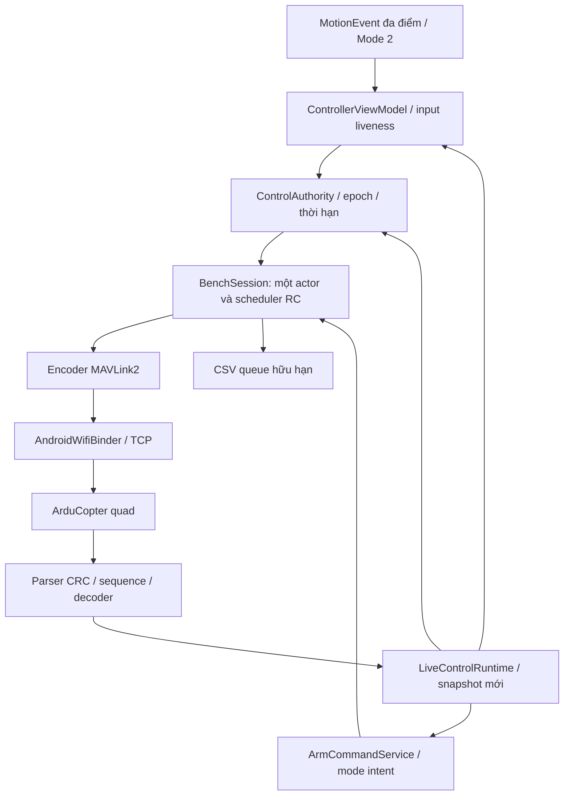

# Kiến trúc và quyền điều khiển — 0.3.0

## Một đường phát, các quyền tách biệt

`BenchSession` giữ một actor nonblocking, một frame pending và một encoder/sequence theo connection. RX được xử lý trước quyết định phát. Profile READ_ONLY dùng telemetry/chẩn đoán; BENCH_4CH phát đủ bốn kênh khi DISARMED; CONTROL là phiên chuẩn bị điều khiển tháo cánh, tiếp tục RC khi FC ARM hợp lệ. BenchEngine cũ chỉ giữ phép CH1 hữu hạn để hồi quy và chẩn đoán ban đầu; chọn profile bốn kênh thu hồi quyền bench cũ. Không có hai scheduler RC chạy song song.

UI cập nhật đầu vào/liveness trên main thread, độc lập actor TCP. Các trục hồi tâm khi nhả đúng pointer, ga giữ tương đối từ điểm chạm. Input và deadman quá 200 ms thu hồi quyền; giữ ga không đồng nghĩa được giữ mãi một input đã quá hạn khi UI treo. Quyền được kiểm tra lại ngay trước mỗi partial write. Nếu một frame điều khiển đã ghi một phần rồi quyền bị thu hồi, đóng TCP; không hoàn tất frame cũ hoặc nối frame mới vào phần còn lại. Backpressure có thời hạn 200 ms. Không catch up các tick RC đã lỡ.

Clock an toàn là monotonic local. Khoảng cách RC dự kiến 50 ms; số Hz và p50/p95/p99/jitter là quan sát socket write, không là độ trễ Wi-Fi/FC. Logger nhận cả snapshot khi hoàn tất RC/command write và ACK; queue 128/dung lượng hữu hạn, dropped/error được hiển thị.

## Điều kiện phiên

| Profile | Điều kiện bắt đầu | Khi ARMED | Dừng |
|---|---|---|---|
| READ_ONLY | TCP/Wi-Fi, khám phá HEARTBEAT | Theo dõi | Không có RC |
| CH1 cũ | Xác nhận tháo cánh/ESC cách ly, calibration, DISARMED, deadman | Thu hồi | CH1 ±20 µs, 750 ms |
| BENCH_4CH | Tháo cánh, ESC cách ly, operator xác nhận, RC readback/mapping hợp lệ, DISARMED | Thu hồi | Lease 30 s, input/HB/echo/session watchdog |
| CONTROL | Tháo cánh, operator xác nhận, FC khỏe, tham số mới, RC mới, ga min/trục giữa, bắt đầu DISARMED | Tiếp tục bốn kênh trong phiên hợp lệ | STOP/lỗi/stale/focus/Wi-Fi hoặc FC DISARM |

Không gán hồ sơ hardware-qualified giả cho operator consent. `enableFlight` cũ vẫn là API kiểm định có provider mặc định từ chối; đường operator thực được gọi riêng và không tuyên bố đã nghiệm thu bay. Không tự tiếp quản một FC đang ARMED khi kết nối.

Ngoại lệ receiverless CRITICAL chỉ dành BENCH_4CH có ESC cách ly: SYS_STATUS mới chỉ báo enabled unhealthy RC/PREARM, không có enabled sensor lỗi khác và không có unhealthy extension. Không cho CONTROL/ARM đi qua ngoại lệ này. Phải xử lý nguyên nhân và chờ FC báo khỏe/PreArm đạt; không thay tham số để vượt cổng. RC echo chỉ là tương quan, không chứng minh override còn hiệu lực sau khi hết hạn.

## Tham số chỉ đọc và mapping

Đọc lại theo từng connection và trước cấp quyền khi hết hạn. Bấm đọc lại điều kiện thu hồi quyền và vô hiệu toàn bộ snapshot an toàn cũ; chờ đủ tập tham số mới, không ghép một phần readback mới với quyền cũ. Đổi bất kỳ tham số bắt buộc nào trong phiên làm thu hồi quyền, kể cả khi giá trị mới không hợp lệ/không giải mã được thành cấu hình hỗ trợ.

| Tham số | Yêu cầu/ý nghĩa |
|---|---|
| MAV_GCS_SYSID / SYSID_MYGCS | Sender 255 phải thuộc phạm vi GCS được chấp nhận |
| MAV_GCS_SYSID_HI | Dải SYSID theo revision; bản cũ không có thì dùng tên legacy phù hợp |
| RC_OPTIONS | Bit1 (giá trị2) ignore override phải tắt. **33 = bit0 ignore receiver + bit5 throttle-idle arming check**, không phải bỏ failsafe |
| RC_OVERRIDE_TIME | Dương và không quá 1 s để mở phiên; tham số đọc về không thay thế phép đo timeout thật |
| RC1–4_MIN/TRIM/MAX/REVERSED | Giá trị hợp lệ theo FC, không dùng mặc định thay readback; hiện hỗ trợ REVERSED=0 |
| RCMAP_ROLL/PITCH/THROTTLE/YAW | Hiện hỗ trợ thứ tự 1/2/3/4 |
| ARMING_RUDDER | Bắt buộc đọc0 để ngăn ARM/DISARM bằng cần yaw; không tự sửa |
| FLTMODE_CH / RC1–4_OPTION | Mode channel0 hoặc5–16; các option trục phải0 để tránh kích hoạt mode/chức năng phụ |
| Failsafe | Chỉ đọc, không tự sửa; không phát kênh phụ |

CH1 roll từ cần phải ngang; CH2 pitch từ cần phải dọc với screen-up → RC thấp; CH3 ga cần trái dọc; CH4 yaw cần trái ngang. Calibration PWM theo từng trục, không giả định 1100/1500/1900 khi FC báo cấu hình khác. CH5–8 luôn 65535 ignore, CH9–18 luôn 0 ignore. Không tự chuyển sang MANUAL_CONTROL hoặc phát hai phương thức cùng lúc.

## ARM/DISARM và chế độ

ARM 400 chỉ theo xác nhận riêng: phiên CONTROL đang phát hợp lệ, RC_CHANNELS mới khớp bốn kênh, ga min và R/P/Y đúng trim, HEARTBEAT mới, SYS_STATUS PreArm present/enabled/healthy và không enabled unhealthy sensor, EKF attitude mới hợp lệ, EXTENDED_SYS_STATE xác nhận đang trên đất. FC vẫn tự kiểm tra PreArm khi nhận lệnh. `param2=0`; không force, không `ARMING_CHECK`/PARAM_SET và không retry tự động.

DISARM thường chỉ theo xác nhận riêng với định danh duy nhất, foreground, heartbeat và tiếp đất mới; không force DISARM trên không. Đường DISARM không bị khóa chỉ vì RC đã STOP, nhưng không được dùng dữ liệu cũ/stream lỗi. Mode 176 theo xác nhận riêng và danh mục ArduCopter; FC có thể từ chối mode. Theo dõi intent, đủ socket write, ACK và HEARTBEAT mới riêng. ACK trước khi frame lệnh ghi xong bị bỏ; ACK không tự xác nhận trạng thái ARM/mode. Không có transaction ID trong ACK400/176 nên vẫn có giới hạn tương quan khi unsigned peer khác cùng SYSID phát lệnh.

## Mất điều khiển và mức bằng chứng

STOP, lỗi parser/session, mất Wi-Fi/focus, input/heartbeat/echo quá hạn thu hồi quyền và xóa input; background đóng socket. Không tự ARM, reconnect, gửi min throttle hay DISARM để giả định an toàn. Kernel/TCP có thể đã giữ byte sau lần write cuối. Mất RC phải được FC xử lý bằng cấu hình failsafe đã kiểm chứng; ứng dụng không thay thế dừng độc lập Wi-Fi.

Các mức quan sát: UI tạo yêu cầu → ghi đủ socket → FC ACK cho lệnh có ACK → HEARTBEAT/RC_CHANNELS phản hồi → nguồn RC/log FC độc lập. RC_CHANNELS_OVERRIDE không có ACK. SITL chỉ chứng minh binary mô phỏng được ghi trong báo cáo; hardware RC, timeout receiverless, động lực và bay của ESP32 còn phải đo riêng.
